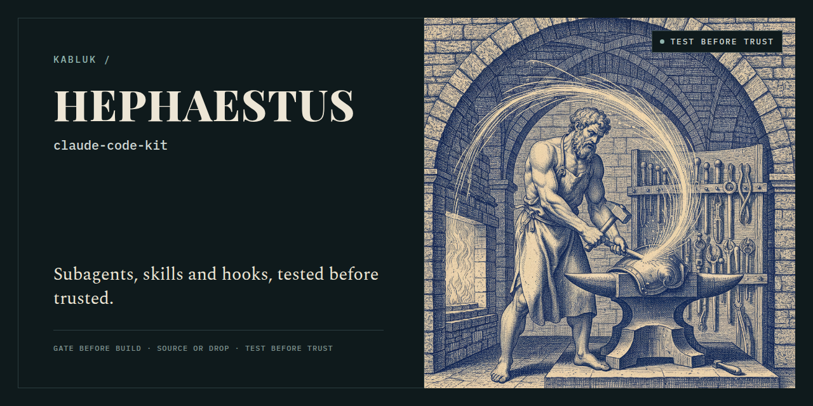
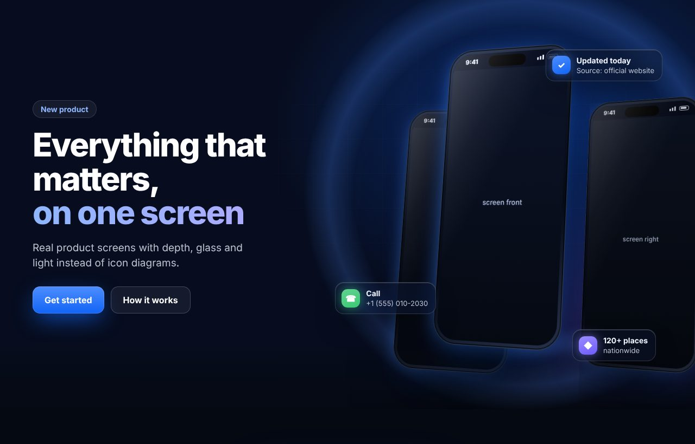

# claude-code-kit



[](https://github.com/kabluk/claude-code-kit/actions/workflows/ci.yml)

Skills, role subagents and slash commands for Claude Code from a solo builder's
workshop, reused across 7+ repositories. Each skill was born from a real failure
in a real project, and says which.

## Install

In Claude Code 2.1.275 or later, install everything as one plugin:

```
/plugin marketplace add kabluk/claude-code-kit
/plugin install solo-builder-kit@kabluk
```

Or copy only what you need into a project (cloud sessions don't follow symlinks,
so copy rather than link):

```bash
git clone https://github.com/kabluk/claude-code-kit ~/claude-code-kit
cp -r ~/claude-code-kit/skills/site-launch your-project/.claude/skills/
```

Later, from the project: `bash ~/claude-code-kit/scripts/kit-sync.sh status` shows which
copies drifted or are missing; `update` and `install ITEM|all` fix them.

## Skills

### Check an idea before building it

| Skill | What it does |
|---|---|
| [`idea-audit`](skills/idea-audit/SKILL.md) | Adversarial audit before a build week: data-source terms, confounders, multi-model kill-tests that must run before any code. *Born when a directory product was designed around a licence register whose terms forbade commercial reuse, found four weeks in.* |
| [`idea-gates`](https://github.com/kabluk/idea-gates) | Six feasibility gates scored against *this* founder, then the market, then red-team, then a verdict. Separate repo. *Born when a service with measured demand died on its first step: the founder could not take it.* |

### Build pages that do not look generated

| Skill | What it does |
|---|---|
| [`glass-stage`](skills/glass-stage/SKILL.md) | A dark premium hero "like Linear or Stripe": real product screens in phones, glass, glow, floating cards, generated backgrounds, in any palette. |
| [`mockup-in-skin`](skills/mockup-in-skin/SKILL.md) | Shows interface options built from the product's own files, not a page drawn from scratch. |
| [`skill-bakeoff`](skills/skill-bakeoff/SKILL.md) | A blind contest between design skills on one product; the owner picks by screenshots, desktop and phone. |
| [`ui-from-screenshot`](skills/ui-from-screenshot/SKILL.md) | Reproduces a design 1:1 with a Playwright + pixelmatch loop until only font rasterisation differs. |
| [`premium-saas-claude-code`](skills/premium-saas-claude-code/SKILL.md) | Structure for SaaS and apps that feel high-end from the first commit. |



*`glass-stage` demo, `night` palette, rendered offline by `node demo.mjs night out/` (placeholder screens, CSS glow only; real product screens and generated art drop in with `--screens` and `--art`).*

### Check quality and UX

| Skill | What it does |
|---|---|
| [`ux-ease-audit`](skills/ux-ease-audit/SKILL.md) | Walks real tasks through a concrete persona's eyes: taps, seconds, dead ends, a 1–10 score, and a re-run that compares against it. |
| [`ux-signoff-loop`](skills/ux-signoff-loop/SKILL.md) | An independent reviewer against fixed rule sets: fix, repeat until it signs off, turn each bug class into a build gate. |
| [`click-audit`](skills/click-audit/SKILL.md) | Clicks every button and checks every link, then says what each control actually did. Finds the button that does nothing. |
| [`gate`](skills/gate/SKILL.md) | Turns a bug fix into a test proven to fail with the fix removed. *Born on a day with five fixes whose tests all had to be proven by hand.* |
| [`external-review`](skills/external-review/SKILL.md) | Collects critique from other LLMs and checks every checkable claim before acting on it. *Of five checkable claims from five models, four were wrong.* |

<details><summary><code>click-audit</code> output on a test page</summary>

```
=== /
links 4 · external 1 · dead 1
  DEAD: Missing -> /missing/
  changes content                    | Change text
  writes state                       | Save
  navigates: /about/                 | Go about
  print                              | Print
  NOTHING                            | Decorative
  disabled (empty field is expected) | Submit
click-audit: dead links 1, NOTHING buttons 1 (verify by hand)
```
</details>

### Launch and run

| Skill | What it does |
|---|---|
| [`site-launch`](skills/site-launch/SKILL.md) | A launch checklist proven against the live URL: one HTTPS host, robots, sitemap, a real 404, analytics that receives an event, legal pages. |
| [`project-pulse`](skills/project-pulse/SKILL.md) | Daily metrics committed to the repo and a weekly analyst that sends the owner a diagnosis and actions. |
| [`repo-scout`](skills/repo-scout/SKILL.md) | Every two days: GitHub repos gaining stars, matched to each of your projects by its profile, README-verified, one concrete use per pick, pushed to your phone. Search runs in Actions, judgement in a Claude routine. |
| [`secrets-and-buttons`](skills/secrets-and-buttons/SKILL.md) | Probes what a token can really do and replaces owner-only buttons with push triggers. *Born on a day one pitfall fired three times.* |

<details><summary><code>site-launch</code> live check on a real public site</summary>

```
PASS  home page 200 at https://www.python.org/
PASS  http://python.org/ -> https://www.python.org/
PASS  http redirect is permanent (301)
PASS  robots.txt 200, no site-wide Disallow
FAIL  sitemap https://www.python.org/sitemap.xml returns 404
WARN  no rel=canonical on home
PASS  missing page returns 404
PASS  HSTS header
…
fails: 1  warns: 2
```
</details>

### Keep sessions focused and memory alive

| Skill | What it does |
|---|---|
| [`project-orchestrator`](skills/project-orchestrator/SKILL.md) | Restores a project's state at session start, splits work across the role subagents, keeps memory in `docs/project/`. |
| [`session-focus`](skills/session-focus/SKILL.md) | One session, one thread: names the goal and the skills it will use, routes other work to a new session, ends every step with three options. *Born on a day one session drifted through five topics.* |
| [`skill-catalog`](skills/skill-catalog/SKILL.md) | One map of every skill, printed at session start, so the right tool is offered instead of improvised. |
| [`harvest`](skills/harvest/SKILL.md) | Turns every repeat into a skill, a rule or a gotcha, and logs it so the next project does not start from zero. *Born after six projects that each started from a blank sheet.* |
| [`context-memory-engineering`](skills/context-memory-engineering/SKILL.md) | Separates what goes into one model call from what persists across calls. |

## What's inside

| Folder | Contents |
|---|---|
| `agents/` | 9 role subagents: backend, frontend, data, devops, QA, architect, product, growth, niche-finder |
| `commands/` | 13 slash commands: `/analyze`, `/discover`, `/deepdive`, `/roadmap`, `/task-loop`, `/workflow-graph`, … |
| `skills/` | 21 skills (above, plus two vendored ones), indexed by job in [`skill-catalog`](skills/skill-catalog/SKILL.md), which also lists recommended third-party skills |
| `hooks/` | `session-start.sh` (start-of-session ritual), `skill-catalog.sh` (prints the catalog into every session, marking what the repo lacks), `thread-check.sh` (repeats the session's thread before every message), `stop-cycle.sh` (no finishing a cycle that had commits without next-step options and a harvest reminder) |
| `scripts/` | `context_monitor.py` (warns before the context window fills, with tests), `check-catalog.sh` (CI: every skill, agent and command has a catalog row), `kit-sync.sh` (install missing items into a project, update drifted copies, honour `.claude/kit-local`), `orphan-branches.sh` |
| `docs/playbook/` | `COLLABORATION.md` (the cross-project rules the hooks refer to), `HARVEST.md` (ledger of extracted lessons) |

## Hooks setup

The hooks and scripts are optional. They expect to live under `.claude/` and the
playbook under `docs/playbook/`:

```bash
cp -r ~/claude-code-kit/{hooks,scripts} .claude/
mkdir -p docs && cp -r ~/claude-code-kit/docs/playbook docs/
cp ~/claude-code-kit/settings.example.json .claude/settings.json   # or merge into yours
```

`settings.example.json` wires them up:

| Event | Command | What it does |
|---|---|---|
| `SessionStart` | `bash .claude/hooks/session-start.sh` | Injects the start ritual and the `caveman` style rules, lists which credentials are set (names only) |
| `SessionStart` | `bash .claude/hooks/skill-catalog.sh` | Prints the skill catalog by job, marking skills this repo lacks, so the session offers the right one |
| `UserPromptSubmit` | `python3 .claude/scripts/task_profiler.py` | Suggests Haiku / Sonnet / Opus for the prompt |
| `UserPromptSubmit` | `bash .claude/hooks/thread-check.sh` | Repeats the session's thread (`session-focus`) so a request for another goal is routed to a new session, not mixed in |
| `UserPromptSubmit` | `python3 .claude/scripts/context_monitor.py` | Warns at 70 % context, hands over a new-session prompt at 85 % |
| `Stop` | `bash .claude/hooks/stop-cycle.sh` | Blocks the end of a cycle that committed without three next-step options |

The hooks need `bash` and `python3`; `session-start.sh` uses `jq` when present.
`context_monitor.py` assumes a 1M-token window; set `CONTEXT_LIMIT_TOKENS` to change it,
and optionally `CONTEXT_HANDOFF_CHECK` to a command the next session should run first.

## Test before trust

The hooks exist because agents finish confidently. `stop-cycle.sh` reads the session
transcript: if the agent committed, pushed or merged since your last message but has not
offered three next-step options, the stop is blocked once, with a reminder to harvest the
lessons into rules or skills first if that has not happened.

## Credits and license

MIT. Two skills are vendored third-party work, each with its own notice and licence:
`skills/writing-for-agents/` from [mattpocock/skills](https://github.com/mattpocock/skills)
(see `skills/writing-for-agents/NOTICE.md`) and `skills/caveman/` from
[JuliusBrussee/caveman](https://github.com/JuliusBrussee/caveman) (see
`skills/caveman/NOTICE.md`).
